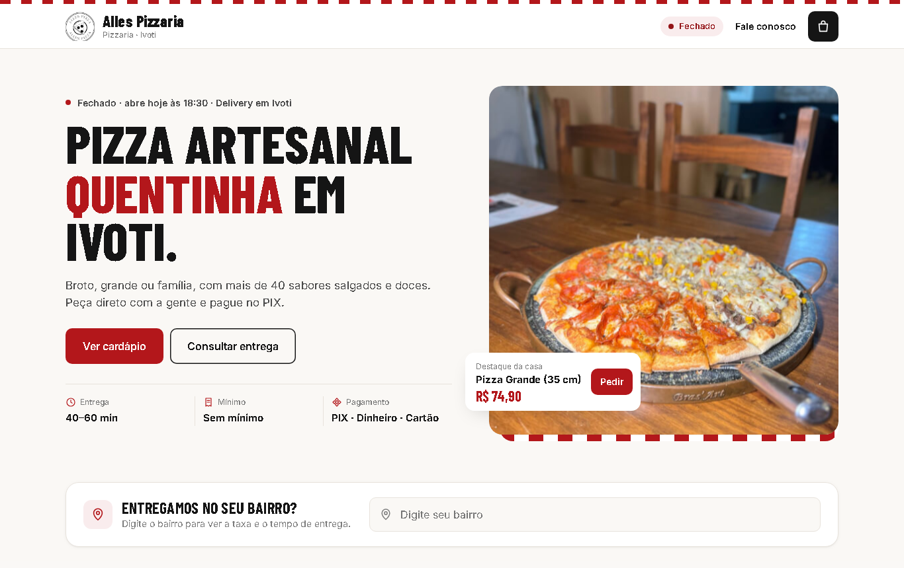
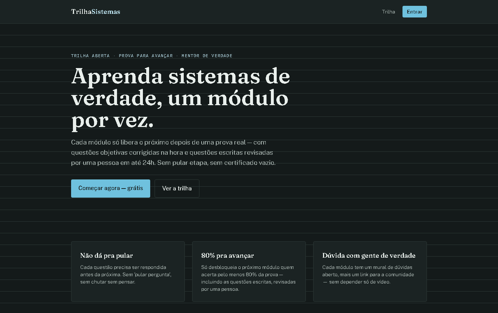

# Victor Natanael · Lutz Solution

Desenvolvo sistemas web sob medida, integrações com WhatsApp e automações com IA.
Igrejinha/RS · atendo todo o Brasil.

WhatsApp (51) 99832-8628 · victorconceicao682@gmail.com

## O que eu faço

- **Sistemas sob medida:** CRM, financeiro, estoque, painéis e controles internos, do jeito que a sua empresa trabalha.
- **Integrações e automação:** faço sistemas diferentes conversarem entre si (ERP, WhatsApp, planilhas, APIs de outros serviços) e automatizo os processos da empresa de ponta a ponta.
- **WhatsApp com IA:** atendente automático que responde e qualifica clientes, avisos e lembretes automáticos.
- **Sites de pedidos:** cardápio online com pedido e pagamento no PIX, sem taxa de aplicativo.
- **Landing pages e sites:** páginas de venda, sites vitrine e institucionais.

## Projetos

### Sites de pedidos para restaurantes

Pedido online direto com o restaurante, feito para 11 pizzarias, hamburguerias e deliveries do RS. O cliente monta o pedido, vê a taxa de entrega do bairro, paga no PIX e o pedido chega pronto no WhatsApp da loja.

[Ver a Alles Pizzaria no ar](https://alles-pizzaria-ivoti.vercel.app) · [Todos os sites e detalhes](https://github.com/VictorNlc/sites-de-pedidos)

### Lutz Motors

Site para loja de seminovos: estoque com filtros, página de cada carro com fotos e vídeos, comparador, simulador de financiamento e atendimento direto no WhatsApp.

[Ver no ar](https://lutzmotors.vercel.app) · [Detalhes](https://github.com/VictorNlc/lutz-motors)

### Trilha Engenharia de Sistemas

Plataforma de estudo gratuita: cada módulo só libera o próximo depois de uma prova, com questões corrigidas na hora, questões escritas revisadas por uma pessoa e mural de dúvidas. Código aberto.

[Ver no ar](https://engenharia-de-sistemas-virid.vercel.app) · [Código](https://github.com/VictorNlc/trilha-engenharia-de-sistemas)

### Sistema comercial da Projefarma

Sistema interno usado pela equipe comercial no dia a dia: CRM de vendas, propostas, financeiro, notas fiscais, fretes, logística de entrega e montagem, e uma atendente de IA no WhatsApp que conversa com os clientes e passa os interessados para os vendedores. É um sistema privado da empresa, então não tem demonstração pública.

## Ferramentas

React · Next.js · TypeScript · Node.js · Supabase · PostgreSQL · OpenAI · WhatsApp (Evolution API) · n8n · Docker · Vercel · PHP · Python
